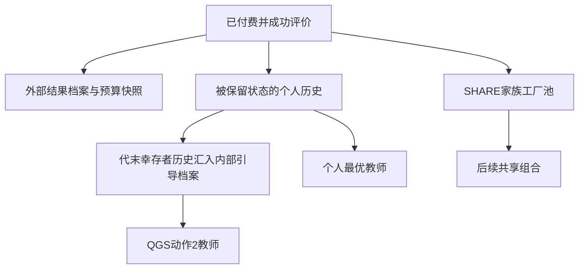

# 反馈时序源码审计：事实与待验证解释

**后续验证入口：** [中央群最后150次结果](中央群最后单一顺序验证结果-2026-11-02.md)已单独检验M,E,W,C全局顺序，近期片段使用增加但未获得清楚共享收益；默认仍为M,C,E,W。下列为原120次审计所对应源码及解释，不按后续质量结果改写。

范围：读取当前受控第四章入口及其本轮冻结副本，不修改反馈策略。数值观察见[120次实际结果](SYNC_JOB归因与反馈时序验证结果-2026-11-02.md)，执行规则见[冻结计划](SYNC_JOB归因与反馈时序验证计划-2026-11-02.md)。本记录不把刷新间隔直接判为错误或性能根因。

## 已确认的路径

1. 每次评价经过BudgetedProblem计费。物理评价成功且通过截止检查后，先进入独立外部结果档案，再触发Anytime与审计回调。外部档案用于预算快照/返回结果，不会自动作为HMOPSO内部引导档案。
2. SearchState的内部引导档案在初始化时逐条offer；普通evaluate本身不向它offer。CanonicalHmopso在代末选择后，将幸存粒子的个人历史交给remember。内部档案成员仍由原ParetoTools决定。
3. 每群QGS有50步，四目标群的粒子数合计100，因此完整一代全局部分固定5000次付费提议。之后还有局搜、选择和个人历史归档，内部引导档案才完成这一代的更新。三个边界群各15、中央群55。Direction.values实际顺序是MAKESPAN、CENTER、ENERGY、WORKER_COST，中央群第二个处理。
4. QGS动作2从内部引导档案做原两候选比较，因此在本代QGS中读取的是最近代末版本。动作1选择当前群的好解；动作0在有previousLeader时复用，否则回退到群内选择。这些通道的更新时序不同。
5. 每次粒子descend都会携带已有个人非支配历史并处理新状态。SHARE的FactoryPool还会在付费结果通过验证后更新，对应家族的后续组合能够使用这些记录；它不等待内部全局档案刷新。

共享池更新及时，不代表立即调用组合。CooperationSupport.compose只在CENTER方向允许组合，因此本代后序ENERGY/WORKER_COST产生的新工厂记录，要到下一代CENTER阶段才有组合机会；局搜阶段产生的记录也同样等待。这个等待事实尚未被策略干预验证为性能原因。

图中各箭头有自己的接受/保留条件，不是每个已付费解都会走完全部路径，也不能把外部一次入档事件等同最终HV贡献。

## 本轮观察什么

记录保存快照的付费FE、首次被内部档案offer/实际接纳时的FE差，及采样QGS步骤的最近刷新FE、教师付费FE和动作。出生时间随快照复制，同一个基因型再次评价是另一次付费发生；不声称跟踪其全局首次发现。

只有QGS动作2可以明确归为内部档案通道。其教师年龄大，可能表示有价值的旧边界解，也可能暴露新信息进入较晚；需要性能对照才能区分。个人历史和共享池有更快路径，不能因此说所有反馈都断开。

外部接纳事件可能随后被支配；截止时未进入内部档案是有截止时间的观察，不代表永久丢失。初始化事件与后续插入延迟分别计数。部分代只能提供已发生的步骤，不能补造代末结果。

本轮只观察这些事实，尚未测试提前刷新、跨群轮转或其他策略，所以不声称改变时序就能追回NSGA-II差距。

对应代码：[BudgetedProblem](../src/java/runtime/BudgetedProblem.java)、[SearchState](../src/java/search/SearchState.java)、[CanonicalHmopso](../src/java/search/CanonicalHmopso.java)、[Particle](../src/java/search/Particle.java)、[CooperationSupport](../src/algorithms/cooperation/CooperationSupport.java)。冻结运行副本和身份记录在本轮实验根目录。
